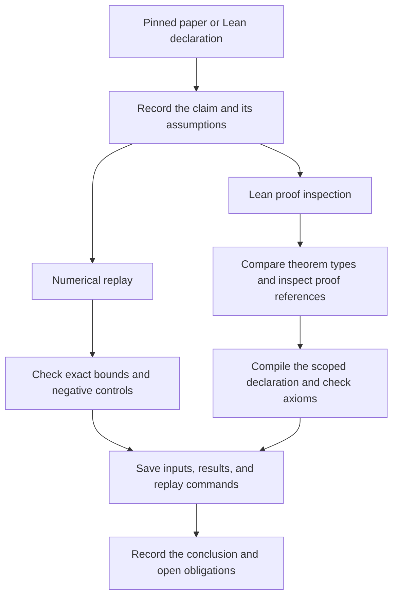
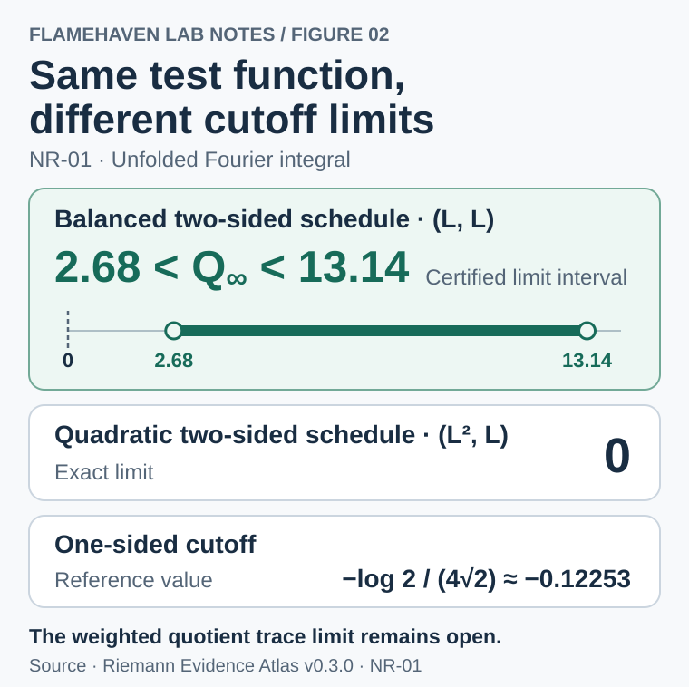

# Riemann Evidence Atlas

**Trace Lean proof dependencies, reproduce exact numerical bounds, and document where mathematical arguments remain open.**

Atlas studies individual steps in Alpöge’s Lean formalization of the Riemann hypothesis and Masullo’s separate trace-formula approach to Hecke GRH. It records the exact claims a calculation or proof check supports, from fixed Landau tail integrals to a conditional theorem about exterior zeros over the rationals.

**Start here** · [After the Proof](docs/writing/after-the-proof/README.md) · [PDF](docs/writing/after-the-proof/after-the-proof.pdf) · [Research case study](docs/RESEARCH_CASE_STUDY.md) · [Roadmap](docs/ROADMAP.md) · [Changelog](CHANGELOG.md)

## Quick start

From a checkout, run the standalone numerical baseline with Python 3.10 or later. It uses the standard library and exercises 51 regression tests, the ten stored numerical cases, and the original notebook's code cells.

~~~sh
python -E -S tools/verify_baseline.py
~~~

The expected final status for the portable checks is `P0_PORTABLE_BASELINE_PASS`.

For the research notebook, supply a full commit SHA and enable `RUN_LEAN` to replay the Lean models. The GitHub workflow runs the numerical notebook cells on its runner. Actual Colab runs have their own execution records. [Replay instructions](docs/LEAN_MATCH_AND_COLAB.md) · [Original ten-case notebook](colab/RH_Window.ipynb)

Run a numerical case directly

The default command emits the ten fixed test cases.

~~~sh
python window_kernel.py
~~~

To test whether the tail integral outside $[1,3]$ is at most $1/200$, save this input as `case.json`.

~~~json
{"component":"outside_window","k":3,"rate":"3","a":"1","b":"3","cap":"1/200","precision_bits":128}
~~~

~~~sh
python window_kernel.py --window case.json
~~~

| Exit code | Meaning |
| --- | --- |
| 0 | The upper endpoint meets the cap. |
| 1 | The lower endpoint exceeds the cap, or the input was rejected. |
| 2 | The interval still straddles the cap. |
| 3 | Another execution outcome occurred. |

The supported domain is $0\le k\le64$, $0\le a<b$, $s>0$, and $sb\le16$. Precision budgets are 128, 256, and 512 fractional bits. The `--ratio` surface also accepts `lambda`, `cap`, and `precision_bits` for a fixed MB-06 regression case. [Numerical baseline](docs/evidence/baseline/window-results-v2.json) · [NSRW provenance](docs/evidence/nsrw/README.md)

## From source to replay

Atlas adapts two MIT-licensed arithmetic and reporting modules from Navier–Stokes Research Workbench. The [NSRW evidence directory](docs/evidence/nsrw/README.md) identifies the upstream inputs and historical cross-checks. [Code attribution and license](NOTICE.md) · [Verification method](docs/CROSS_REPO_WORKFLOW_AND_VERIFICATION_SPEC.md)

## What the evidence supports

| Research question | What Atlas established | Evidence |
| --- | --- | --- |
| Does the numerical interval enclose the real Landau tail? | Lean confirms the exact value and enclosure for two fixed cases. A close comparison remains undecided at 128 bits and passes at 256 bits in the second case. | [First case](docs/P3_LANDAU_TAIL.md) · [Second case](docs/LANDAU_SECOND_CASE.md) |
| Does the cutoff schedule change the unfolded limit? | Yes, for the fixed test studied in NR-01. The quadratic schedule gives zero and the balanced schedule gives a certified positive interval. NR-02 records a separate Schwartz–Bruhat domain obstruction. | [Negative results](docs/masullo/NEGATIVE_RESULT_REGISTER.md) |
| Can the existing Dirichlet theorem supply the exterior-zero step? | The conditional Lean application compiled in Colab 4.36.0. Direct use of the original Alpöge proof term in the same environment remains open. | [Lean declaration](docs/evidence/rational-exterior/ConditionalApplication.lean) · [Replay and import records](docs/masullo/RH_PROOF_COMPOSITION_REPLAY.md) |
| Does the weighted trace agree with the manuscript’s Step III diagonal? | Atlas constructed the fixed-cutoff trace density for the studied sector. The Step III identification and joint cutoff limit remain open. | [Weighted quotient](docs/masullo/S_LOCAL_WEIGHTED_QUOTIENT.md) · [Next research question](docs/ROADMAP.md#next-research-question) |

View the cutoff comparison chart

The Lean CI job replays the baseline and 28 additional declarations with Lean 4.33.1 and pinned Mathlib. The separate Colab 4.36.0 evidence covers the rational exterior-zero application. [CI workflow](.github/workflows/checks.yml) · [Mathlib lock](formal/landau/lake-manifest.json) · [Archived Colab evidence](docs/evidence/rational-exterior/)

## Repository guide

| Location | Start here |
| --- | --- |
| [`riemann_evidence/`](riemann_evidence/) and [`tools/`](tools/) | Python modules, replay commands, and source indexing utilities. |
| [`formal/`](formal/) and [`tests/lean/`](tests/lean/) | Pinned Lean project and formal statements. |
| [`colab/`](colab/) and [`docs/evidence/baseline/`](docs/evidence/baseline/) | Replay notebooks and preserved numerical baselines. |
| [`docs/evidence/source-index/`](docs/evidence/source-index/) | Source inventory, archive pins, static proof trace, and PDF index. |
| [`docs/evidence/nsrw/`](docs/evidence/nsrw/README.md) | NSRW MB-06 cross-check records, input provenance, and negative control. |
| [`docs/masullo/`](docs/masullo/) | Trace formulas, weighted-space models, and the rational exterior-zero study. |

Original sources and proof-dependency replay

Start with the [source inventory](docs/evidence/source-index/sources.json), [Lean archive manifest](docs/evidence/source-index/lean-archive-manifest.json), and [extraction manifest](lean-extract-manifest.json). Put the original fragments at the specified `sources/lean-parts/` paths. Then run:

~~~sh
python tools/verify_lean_archive.py
python tools/trace_lean.py
~~~

The [proof-dependency pilot](docs/PROOF_DEPENDENCY_PILOT.md) records direct type and proof-term references from compiled objects. The [static trace](docs/evidence/source-index/rh-proof-trace.json) records source imports. Full transitive closure and Atlas’s kernel replay of the complete original proof remain open.

The optional `pypdfium2` package supports `python tools/index_sources.py`. The four intake PDFs have a [page index](docs/evidence/source-index/pdf-pages.jsonl). The source catalog also preserves the separately pinned Masullo manuscript.

The archived notebook and Landau receipt pin `window_kernel.py`, `landau_second_case.py`, and `lean-extract-manifest.json` at their existing root paths or hashes. The [original receipt](docs/standalone-replay.json) records the historical paths, which are available in the [v0.3.0 tree](https://github.com/Flamehaven-Labs/riemann-evidence-atlas/tree/v0.3.0).

[Research roadmap](docs/ROADMAP.md) · [v0.3.0 research release notes](docs/RELEASE_V0.3.0.md) · [Engineering research report](docs/ENGINEERING_RESEARCH_REPORT.md) · [Related writing](docs/RESEARCH_CASE_STUDY.md#related-reading)
