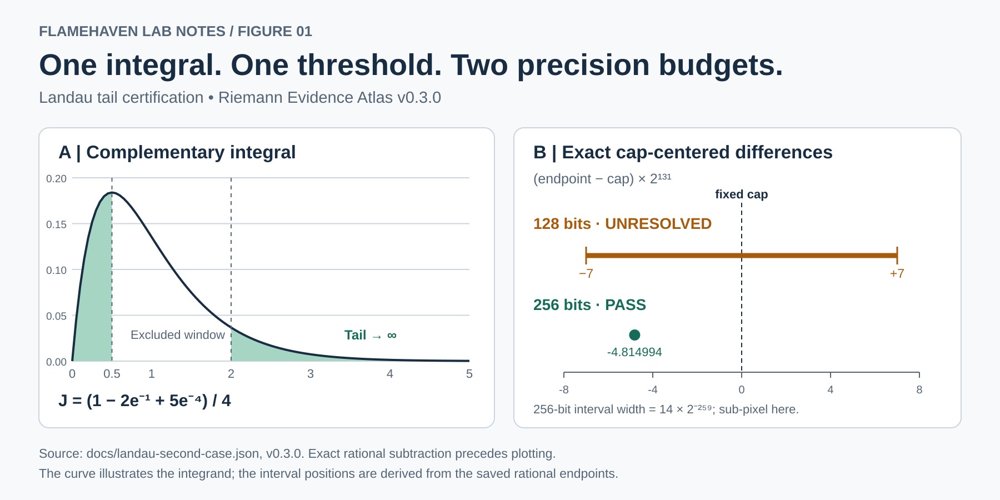
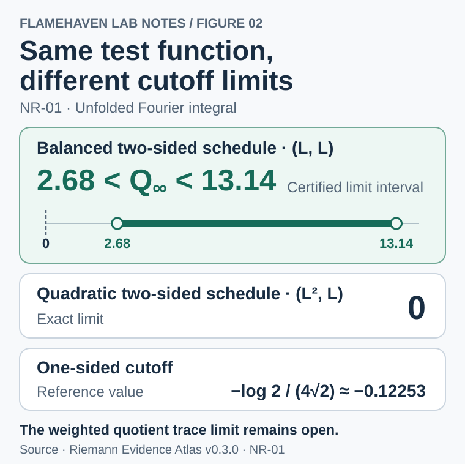
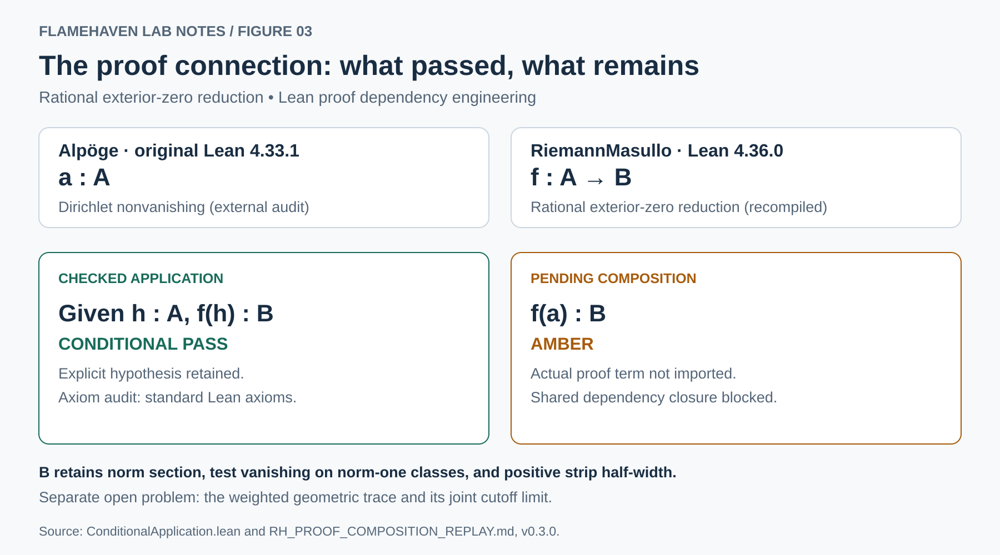

# After the Proof: What a Lean Proof of the Riemann Hypothesis Can Tell Us Next

*Flamehaven Lab Notes — Equation to Artifact*\
**Research Dev Log · Editorial v1.0 · November 28, 2026 · Atlas v0.3.0**

A proof checker can tell us whether a formal theorem follows from its assumptions. Our question was what a researcher could do with that proof next. In the Riemann Evidence Atlas, we tested this by tracing specific claims back to their Lean declarations, checking which assumptions carried over, and recording where the connections stopped.

Our starting point is Levent Alpöge’s AI-assisted Lean formalization of RH and the specified Dirichlet L-function statements, as recorded in the archived independent verification reports. Alongside it, we study Alessandro Maria Masullo’s *The Music of the Primes*, a separate trace-formula approach to Hecke GRH whose public formalization contains unresolved steps. Atlas compares individual arguments, reproduces checkable computations, and records the boundary of each connection. It does not establish a new RH proof or validate Masullo’s independent route by borrowing its desired conclusion.

[Independent audit](https://math.mit.edu/~drew/grh/) · [Shorter formalization audit](https://math.mit.edu/~drew/shortgrh/) · [Masullo formalization and errata](https://github.com/mccorvie/riemann-masullo) · [Atlas repository](https://github.com/Flamehaven-Labs/riemann-evidence-atlas)

## Part I — Bringing our verification framework to Riemann

### What carried over from QSOT and NSRW

Two earlier Flamehaven investigations gave us a starting point: QSOT's way of classifying scientific claims and NSRW's code for checking numerical bounds.

QSOT-Harness exposed a problem familiar in scientific AI: a program may execute, emit sophisticated mathematical output, and still fail to establish the scientific claim associated with it. Its evidence classes distinguish what was calculated, which checks ran, and what remains unverified. Atlas adopts that reporting discipline without requiring QSOT as a runtime dependency. See [Verified Comes in Grades](https://flamehaven.space/writing/qsot-harness-verified-comes-in-grades-and-pretending-it-doesnt-is-where-slop-begins/) and the [QSOT-Harness repository](https://github.com/Flamehaven-Labs/QSOT-Harness).

The Navier–Stokes Research Workbench developed the computational side. Our earlier [scale-invariant candidate investigation](https://flamehaven.space/writing/from-a-scale-invariant-candidate-to-an-obstruction-what-changed-while-reproducing-a-navierstokes-construction/) moved from reproducing a candidate quantity to identifying a precise obstruction. [NSRW Part 1](https://flamehaven.space/writing/navier-stokes-research-workbench-when-one-moment-cancels-and-another-stays-positive/) followed mass cancellation and a positive angular history at the same radius. [Part 2](https://flamehaven.space/writing/navierstokes-research-workbench2-a-rejected-zero-hypothesis-a-missing-archive-and-a-repaired-lean-proof/) separated a rejected hypothesis, missing evidence, and a repaired Lean proof. [Part 3](https://flamehaven.space/writing/navierstokes-research-workbench3-from-proof-to-a-bounded-numerical-diagnostic/) connected a source-derived bound to a bounded computation and diagnostic benchmark.

Those investigations accumulated exact arithmetic, source-bound statements, negative controls, verification runners, and replay receipts. The mathematics did not transfer from fluid dynamics to number theory. The verification components did.

Atlas adapts two NSRW modules: the scalar kernel’s rational exponential enclosure functions, now in [riemann\_evidence/rational\_intervals.py](https://github.com/Flamehaven-Labs/riemann-evidence-atlas/blob/v0.3.0/riemann_evidence/rational_intervals.py), and the research verification runner, now in [riemann\_evidence/verification.py](https://github.com/Flamehaven-Labs/riemann-evidence-atlas/blob/v0.3.0/riemann_evidence/verification.py). Their upstream revision is 6119a2208e1992c1ecea5c9862eac712d604e77f. The [NOTICE](https://github.com/Flamehaven-Labs/riemann-evidence-atlas/blob/v0.3.0/NOTICE.md) records source attribution and file digests; the [NSRW specification](https://github.com/flamehaven01/NavierStokes-Research-Workbench/blob/6119a2208e1992c1ecea5c9862eac712d604e77f/docs/NSRW_RESEARCH_VERIFICATION.md) describes the inherited verification discipline.

| Research asset | What Atlas uses |
| --- | --- |
| QSOT-Harness | Evidence classification and explicit claim boundaries; no runtime dependency |
| NSRW | Actual rational interval and verification code; source-bound checks and replay discipline |
| Atlas | Declaration-type inspection, proof-value references, module import analysis, formal models and theorem applications |

### The method: audit a fixed claim

For a numerical claim, preserve the input, enclosure, threshold and rejection control. For a Lean claim, read its elaborated proposition and hypotheses, record proof references, and compile in a pinned environment. When a theorem from another development appears applicable, compare its mathematical interface with an independently specified target. Missing assumptions are obligations, not conveniences to omit. A checked application and the subsequent axiom audit are separate from an informal claim that two arguments are equivalent.

At the assessment level, ACCEPT means that the available evidence supports the bounded claim; AMBER means that a required check or mathematical connection remains open; REJECT means that the proposed inference is ruled out. Execution states are more granular. A missing import is not a counterexample. An interval straddling a threshold is not evidence that the inequality is false.

This is **claim custody**: preserving a narrow, checkable claim with enough source context, executable code, expected output, environment and boundary documentation that another person can inspect, rerun and challenge it. A proof establishes a theorem; an executable artifact preserves the checkable surface. See the [cross-repository verification specification](https://github.com/Flamehaven-Labs/riemann-evidence-atlas/blob/v0.3.0/docs/CROSS_REPO_WORKFLOW_AND_VERIFICATION_SPEC.md).

### Follow one calculation: the Landau tail

Alpöge’s Landau-window argument contains a positive integral kernel of the form $u^k e^{-ru}/k!$, with $r=\sigma-2>0$. Atlas isolates the integral in Deduction.landau\_window\_ineq, excluding its external factor $2C_0$, and chooses fixed parameters independently. In the second case, $k=1$, $r=2$, and the excluded interval is $[1/2,2]$.

$$
J=\int_0^{1/2}ue^{-2u}\,du+\int_2^\infty ue^{-2u}\,du
=\frac{1-2e^{-1}+5e^{-4}}4.
$$

The value is approximately 0.08895482802519657. The interesting question is not how many decimal digits we can display, but whether a certified rational enclosure resolves a fixed comparison.

| Comparison | Fractional bits | Result |
| --- | --- | --- |
| $J\leq 1/10$ | 128 | PASS |
| $J\leq 1/20$ | 128 | FAIL |
| $J\leq c_*$ (fixed close rational cap) | 128 | UNRESOLVED |
| $J\leq c_*$ (same cap) | 256 | PASS |

The NSRW-derived arithmetic constructs outward-rounded bounds. At 128 bits the interval straddles the cap; at 256 bits its upper endpoint lies below it. Lean separately proves the real integral identity and inclusion in the saved rational enclosure, together with threshold comparisons. The Python receipt itself marks the formal proof NOT\_RUN; the Lean evidence is a separate execution record. This separation is intentional.



*Figure 1. Complementary Landau tail and the cap-centered interval comparison. The exact rational differences are computed before conversion to plotting coordinates. In units of $2^{-131}$, the 128-bit endpoints are −7 and +7; both 256-bit endpoints round to −4.814994 at this scale. Its width is exactly $14\cdot2^{-259}$, so the plotted marker represents an interval narrower than a pixel, not a zero-width certificate.*

The calculation demonstrates portability of the verification infrastructure, not of the original fluid-dynamical result. Atlas adds the new number-theoretic specialization and formal connection. Two fixed Landau cases are certified; the full Landau argument and the entire RH proof are not replayed by these checks.

[Second Landau case](https://github.com/Flamehaven-Labs/riemann-evidence-atlas/blob/v0.3.0/docs/LANDAU_SECOND_CASE.md) · [Exact numerical receipt](https://github.com/Flamehaven-Labs/riemann-evidence-atlas/blob/v0.3.0/docs/landau-second-case.json)

## Part II — Inside the Riemann Evidence Atlas

### Reading mathematics through declarations

Atlas is an open-source research repository maintained by Flamehaven Labs. Its aim is to follow the two mathematical approaches step by step, identify the assumptions enabling their conclusions, and turn questions arising from the comparison into checkable lemmas, counterexamples, or models.

The declaration inspection distinguishes three kinds of dependency: the constants in a theorem’s type, the constants referenced by its proof value, and the modules imported by its source. An import is not necessarily used by a particular proof, and direct references do not give a complete transitive closure. This matters when attempting to extract a useful part of a large formal development rather than rebuilding all of it.

This distinction became practical when we moved from declaration inspection to the trace-formula calculations. [Proof dependency pilot](https://github.com/Flamehaven-Labs/riemann-evidence-atlas/blob/v0.3.0/docs/PROOF_DEPENDENCY_PILOT.md).

### Two negative results and a constructive starting point

**NR-01 — Cutoff dependence in an unfolded expression.** We fixed the G1 radial test over the rationals, comparing the real place with the real and 2-adic places, and varied only the growth of the two upper cutoff scales. The contrast in Figure 2 rules out schedule independence for the unfolded expression. The two-sided model includes a lower-frequency hole absent from the printed Step II cutoff.



*Figure 2. With the test function fixed, the quadratic two-sided cutoff gives an unfolded Fourier integral with limit zero. Under the balanced cutoff, the limit lies strictly between 2.68 and 13.14. Whether this dependence on the cutoff schedule persists for the weighted quotient trace remains open.*

**NR-02 — A domain obstruction.** For a concrete Schwartz–Bruhat function on $\mathbb R\times\mathbb Q_2$, the product-norm frequency multiplier can destroy uniform finite-place local constancy. The analytic counterexample and selected Lean witness checks expose a failure of domain preservation for this multiplier. They do not refute RH or rule out every repaired trace construction.

There is constructive progress as well: at fixed cutoffs, the studied trivial-angular weighted quotient compression admits an integrable trace density. Its identification with the manuscript’s Step III diagonal, joint cutoff limit, and global–local comparison remain open.

These results are findings within specified models. Their broader novelty has not been established by independent literature review. [Negative Result Register](https://github.com/Flamehaven-Labs/riemann-evidence-atlas/blob/v0.3.0/docs/masullo/NEGATIVE_RESULT_REGISTER.md) · [Weighted quotient](https://github.com/Flamehaven-Labs/riemann-evidence-atlas/blob/v0.3.0/docs/masullo/S_LOCAL_WEIGHTED_QUOTIENT.md).

### Development checkpoint: v0.3.0

On November 28, 2026, Atlas published a versioned research checkpoint at commit 3803d500db4ed60e3435091bec73378372889afb. The English README, changelog, case study, release notes, roadmap and evidence records were updated; the commit was pushed and tagged. A versioned release allows later researchers to distinguish the evidence available at this checkpoint from subsequent work.

| Research item | Evidence boundary |
| --- | --- |
| Two Landau tail cases | Exact enclosures and fixed formal statements |
| NR-01 / NR-02 | Scoped negative results |
| Fixed-cutoff weighted trace | Analytic construction; joint limit OPEN |
| Fourier residual estimates | Certified bounds; insufficient certificate |
| Rational exterior-zero reduction | Conditional Lean application PASS |
| Direct Alpöge proof composition | AMBER |

All six GitHub Actions jobs succeeded at the release commit: Windows and Ubuntu with Python 3.10 and 3.14, research models and Colab notebook cells, and Lean 4.33.1 with pinned Mathlib. The standalone suite has 51 tests. The separate Lean 4.36.0 Colab replay is documented by source, receipts and logs, not covered by the same Lean CI job. The release audit reported 51/51 standalone tests on Windows/Python 3.14.10 and 13/13 public evidence manifest files matching. These are bounded checks, not a fresh verification of every analytic or formal claim.

#### Reproduce the checks

```bash
git clone https://github.com/Flamehaven-Labs/riemann-evidence-atlas.git
cd riemann-evidence-atlas
git checkout v0.3.0
python -E -S tools/verify_baseline.py
sha256sum --check docs/evidence/rational-exterior/SHA256SUMS
```

Execution states in [verification.py](https://github.com/Flamehaven-Labs/riemann-evidence-atlas/blob/v0.3.0/riemann_evidence/verification.py): PASS, FAIL, UNRESOLVED, ENV\_BLOCKED, NOT\_RUN, ERROR. A computational report has claim\_authority: NONE and claim\_status: UNVERIFIED; neither field is a substitute for a separate mathematical proof.

| Resource | Purpose |
| --- | --- |
| [README](https://github.com/Flamehaven-Labs/riemann-evidence-atlas/blob/v0.3.0/README.md) | Scope and quick start |
| [Changelog](https://github.com/Flamehaven-Labs/riemann-evidence-atlas/blob/v0.3.0/CHANGELOG.md) | Development history |
| [Release notes](https://github.com/Flamehaven-Labs/riemann-evidence-atlas/blob/v0.3.0/docs/RELEASE_V0.3.0.md) | Verification scope |
| [Case study](https://github.com/Flamehaven-Labs/riemann-evidence-atlas/blob/v0.3.0/docs/RESEARCH_CASE_STUDY.md) | Research account |
| [Lean evidence](https://github.com/Flamehaven-Labs/riemann-evidence-atlas/tree/v0.3.0/docs/evidence/rational-exterior) | Source, axioms, receipts and blockers |
| [Roadmap](https://github.com/Flamehaven-Labs/riemann-evidence-atlas/blob/v0.3.0/docs/ROADMAP.md) | Next obligations |

[Release v0.3.0](https://github.com/Flamehaven-Labs/riemann-evidence-atlas/releases/tag/v0.3.0) · [CI run 46115618904](https://github.com/Flamehaven-Labs/riemann-evidence-atlas/actions/runs/46115618904) · [Evidence ZIP](https://github.com/Flamehaven-Labs/riemann-evidence-atlas/releases/download/v0.3.0/atlas-rational-exterior-local-evidence-2026-11-28.zip)

Recorded ZIP SHA-256: 17859977e1639dbb5907aff664db6698a4f6bfe4de2846277b446fb3491f87d3. Hash agreement establishes file integrity, not a new kernel replay.

## Part III — After the proof: from verification to proof dependency engineering

### What a verified proof can tell us next

As mathematicians and AI systems tackle difficult problems, the ability to check a formal proof is an essential advance. It does not, however, remove the work of understanding that proof. Masullo’s pinned November 20, 2026 manuscript has 940 pages; Atlas’s source import scan reaches 175,187 project modules from Alpöge’s original Main. A shorter formalization of the same five audited endpoints also exists. These figures describe different artifacts, not comparable counts of proof steps.

The question that persists regardless of length is which definition, assumption and auxiliary theorem supports the conclusion a researcher needs. Atlas approaches this by working backwards from a named obligation. [Masullo source inventory](https://github.com/Flamehaven-Labs/riemann-evidence-atlas/blob/v0.3.0/docs/masullo/README.md) · [Original audit](https://math.mit.edu/~drew/grh/) · [Shorter audit](https://math.mit.edu/~drew/shortgrh/).

### When verification hits a wall

NR-01 left us with a more difficult question: whether the cutoff dependence survives the weighted quotient projection. We studied the fixed-cutoff compression $P_{S,Y}M_mA_kK_qP_{S,Y}$, whose weighted projection, spatial multiplier, convolution and descended frequency gate must be related to the manuscript’s geometric diagonal.

Writing $E=P-P_N$ for the difference between the full and finite-dimensional projections, a nuclear expansion leads to an error estimate of the form $\sum_j |c_j|\|Ea_j\|\|Ev_j\|$. It is a useful sufficient bound, but the absolute values discard cancellation.

At $L=4$, strip parameter $\alpha=1/8$, 128 cells and a period-two Fourier expansion, the reported finite-basis difference between schedules was 1.2054450173. The constant-term certificate was bounded by 0.4503, leaving a **provisional error allowance inferred from the finite-basis calculation** of 0.7551450173 for the intended infinite-dimensional comparison.

The certified first conjugate Fourier-pair bound alone was 65.23790 — approximately 86.39 times that provisional allowance. Its coefficient was enclosed at 160-bit Arb precision, with $2.02129<|c_1|<2.02253$. The signed 128-to-256-cell changes in the schedule difference were approximately +0.03846 and +0.04155 in two quadrature settings. Those finite changes suggest cancellation but cannot certify the infinite-dimensional remainder; the observed gap itself carries numerical uncertainty.

Unlike the Landau case, evaluating the same overly large sufficient bound more precisely would not necessarily close the mathematical obligation. The failed comparison rejects the certificate’s sufficiency, not the trace identity. The actual signed error and joint weighted trace limit remain unknown.

We therefore revisited the obligation list before investing further in the same numerical strategy. This did not solve the trace problem. It exposed a separate question for which relevant verified mathematics already existed: the rational exterior-zero sum.

[First Fourier-pair certificate](https://github.com/Flamehaven-Labs/riemann-evidence-atlas/blob/v0.3.0/docs/masullo/S_LOCAL_FIRST_HARMONIC.md)

### Reading the rational exterior-zero proof

Alpöge’s archived source gives the declaration:

```txt
theorem LFunction_ne_zero_of_half_lt_re :
    DirichletLNonvanishingRightOfHalf := allChi
```

Its proposition expands to:

```txt
∀ (N : ℕ) [NeZero N]
  (χ : DirichletCharacter ℂ N) (s : ℂ),
  1 / 2 < s.re →
  (χ ≠ 1 ∨ s ≠ 1) →
  DirichletCharacter.LFunction χ s ≠ 0
```

The exceptional-point guard matters: deleting it changes the proposition at the principal character and $s=1$. Matching a theorem name is not enough. The quantified modulus, character type, real-part inequality and guard must all agree.

The pinned RiemannMasullo source at 6dfe34ef2ef48f1f2c2cfd2274b73663a0eac07c contains traceFormula\_exteriorZeros\_rat\_of\_dirichletGRH with the same expanded premise. The conclusion concerns the rational field, a continuous multiplicative norm section $\tau$ that is a right inverse to the idelic norm, a compactly supported Bruhat test function $\phi$ **vanishing on the norm-one classes**, and a positive strip half-width $\alpha$.

Why does a right-half-plane theorem settle a sum indexed by exterior zeros on *both* sides? The proof body answers this. For each rational idelic character $\psi$ trivial on the norm section, the upstream classification identifies a primitive Dirichlet character whose L-series agrees with the finite Hecke L-function on $\operatorname{Re}s>1$. Meromorphic continuation and the nonvanishing archimedean factor in the right half-plane relate the orders of the continued completed Hecke L-function and the Dirichlet L-function. A hypothetical positive divisor order with $\operatorname{Re}s>1/2$ forces $\operatorname{Re}s<1$ by the completed-function zero-strip result, so $s\neq1$. Dirichlet nonvanishing and analyticity give order zero, contradicting positivity.

On the left, the inverse character $\psi^{-1}$ is also trivial on the norm section. The functional-equation reflection theorem transports the right-side exclusion for that inverse character to the left-side exclusion for $\psi$. At $\operatorname{Re}s=1/2$, the condition $\alpha\leq|\operatorname{Re}s-1/2|$ contradicts $\alpha>0$. Thus no element of the exterior-zero index type exists, including at the strip boundary. The sum over the empty index type has value zero.

The key intermediate declarations are exists\_primitive\_finiteHeckeL\_eq\_of\_trivial\_on\_section, meromorphicOrderAt\_finiteHeckeL\_continuation, order\_nonpos\_of\_half\_lt\_re and isEmpty\_exteriorZeros\_of\_dirichletGRH. They are existing upstream results, not new Atlas lemmas. The upstream theorem’s comment explicitly records the deviation from the printed unconditional argument: it is over the rationals and assumes Dirichlet GRH. It does not establish arbitrary-number-field Hecke GRH.

[Pinned upstream proof, including the reflection and final sum](https://github.com/mccorvie/riemann-masullo/blob/6dfe34ef2ef48f1f2c2cfd2274b73663a0eac07c/RiemannMasullo/Ch13_ZerosHecke/RationalExteriorZeros.lean#L614)

### What actually compiled

Let $A$ be the exact Dirichlet nonvanishing proposition, and $B$ the rational exterior-zero result with the norm section, test-function vanishing and positive-width conditions retained. Alpöge provides $a:A$ in the external audited development. The existing reduction supplies $f:A\to B$. Atlas’s published declaration is:

```txt
theorem atlas_exterior_zeros_of_archived_statement
    (h : DirichletLNonvanishingRightOfHalf) :
    atlas_type_of%
      (@RiemannMasullo.traceFormula_exteriorZeros_rat_of_dirichletGRH h) :=
  @RiemannMasullo.traceFormula_exteriorZeros_rat_of_dirichletGRH h
```

The archived proposition passed definitional equality under Lean 4.33.1 and 4.36.0. In the latter environment, Colab recompiled the pinned upstream target using verified cached imports and checked the conditional application. Its audited axiom list is propext, Classical.choice, Quot.sound; no sorryAx appears. The explicit hypothesis remains a parameter, so its absence from the axiom list does not discharge it.



*Figure 3. The checked application $h:A\vdash f(h):B$ and the pending direct composition $f(a):B$. The latter requires a compatible Lean and Mathlib environment and the original proof dependency closure. The geometric trace is a separate open obligation.*

The direct proof-object import has not succeeded. Windows probes encountered missing Statements.olean and a private-object loading error. The 4.33.1 Linux import reached missing Formalism modules and, after adding a hash-verified object, missing Development modules. The shared 4.36.0 source probe stopped at Supplements.Kernels.MainTheoremsCritical. These are environment or dependency blockers before the intended composition could be checked. They do not establish a mathematical contradiction, nor do they guarantee a successful future port.

The local conditional application is PASS; the actual cross-project composition remains AMBER. The original external proof audit and Atlas’s scoped replay have different custody boundaries.

[ConditionalApplication.lean](https://github.com/Flamehaven-Labs/riemann-evidence-atlas/blob/v0.3.0/docs/evidence/rational-exterior/ConditionalApplication.lean) · [Proof and import records](https://github.com/Flamehaven-Labs/riemann-evidence-atlas/blob/v0.3.0/docs/masullo/RH_PROOF_COMPOSITION_REPLAY.md)

## Part IV — Engineering reusable mathematical knowledge

### From a verified theorem to a reusable dependency

In software engineering, an existing library may satisfy a missing implementation if its interface is compatible. Formal mathematics has a related but more exact structure: a proof of $A\to B$ can be applied to a proof of $A$. A mathematical adapter is itself a proved implication, equivalence or transport lemma, not a change to the specification.

Suppose one development establishes $P\to Q$, while another establishes $R\to S$. The missing connection may be $Q\to R$. If it is proved, the composition yields $P\to S$. In Lean, this has the elementary structure:

```txt
theorem composed {P Q R S : Prop}
    (f : P → Q) (adapter : Q → R) (g : R → S) :
    P → S :=
  fun hp => g (adapter (f hp))
```

This illustrative declaration is not a new replay receipt. Its significance is that the adapter can concentrate new work on the precise gap between known results. Reuse applies an existing theorem; adaptation proves a necessary connection; discovery establishes a genuinely new result, whose novelty requires separate review.

A large proof’s intermediate results — integral bounds, convergence lemmas, operator identities, nonvanishing statements — may therefore be useful independently of its headline theorem. But relevance must be demonstrated through their exact hypotheses and dependencies. A Lean proof in Prop is a reusable logical asset, not automatically an executable numerical algorithm or constructive witness.

### A disciplined approach to proof reuse

Before attempting another derivation, fix the intended mathematical proposition independently; compare the definitions, hypotheses and normalizations of existing checked theorems; then prove any necessary adapter and compose the actual proof terms in a compatible pinned environment. Inspect transitive axioms, preserve source attribution and replay evidence, and reject weakened targets, hidden assumptions or circular dependencies. The present conditional application infers its type from the pinned upstream application; it has not yet discharged its explicit GRH premise using Alpöge’s proof. Mathlib, Lake and retrieval-augmented theorem proving already provide foundations for this work. Our proposed research direction emphasizes cross-project claim custody, not a completed automated system or a demonstrated advantage over existing approaches. [Detailed methodology](https://github.com/Flamehaven-Labs/riemann-evidence-atlas/blob/v0.3.0/docs/WHEN_VERIFICATION_HITS_A_WALL_PROOF_ARTIFACT_COMPOSITION.md) · [Mathlib](https://github.com/leanprover-community/mathlib4) · [LeanDojo, NeurIPS 2023](https://arxiv.org/abs/2306.15626) · [Lean proof validation](https://lean-lang.org/doc/reference/latest/ValidatingProofs/).

### Why it matters to AI and software researchers

The case exposes measurable tasks even without solving an entire mathematical problem: retrieving a theorem with the right hypotheses; rejecting a changed normalization or exceptional-point guard; constructing a valid adapter without weakening the target; distinguishing an import failure from a failed proof; and preserving the evidence behind the decision. The relevant performance metrics could include retrieval accuracy, kernel-accepted adapters, unchanged obligations discharged, failure-classification accuracy and dependency build cost. Such evaluations remain future work.

For mathematicians, the same records identify where a new argument is actually required. For AI developers, they give concrete targets for evaluating reasoning and knowledge reuse rather than simply counting generated proofs. For software engineers, they connect reproducible builds to mathematical semantics.

The original theorems remain their authors’ results. Our interest is in making their precise claims and dependencies usable in the next research problem, without treating reuse as a new proof.

### The next checkpoint

For a possible Atlas v0.4.0 checkpoint, the proposed acceptance targets are an exact Step III correspondence or a proved structural mismatch; a necessary condition or obstruction for the relevant weighted joint limit; or a direct cross-project proof-term composition under audited dependencies. These are research targets, not promised release features. Any one, rigorously established within its scope, would justify a meaningful checkpoint.

The proof-reuse track should first obtain one small, fully audited composition rather than build an elaborate automated system. It must remain distinct from the independent Masullo investigation: the upstream project excludes contributions derived from the November 2026 RH formalization. External GRH cannot be used to claim that its independent geometric argument has been repaired.

The main mathematical priority is still Step III. We will compare the operator ordering, weighted projections, Haar normalization, quotient diagonal and cutoffs at fixed parameters. If the source comparison permits the two-sided schedule, the next question is whether the nonzero unfolded low-frequency contribution along $(L^2,L)$ survives the weighted projection. That is a specific unresolved question, not a promise of a general trace result.

[Roadmap — next research question](https://github.com/Flamehaven-Labs/riemann-evidence-atlas/blob/v0.3.0/docs/ROADMAP.md#next-research-question)

Our next deliverable is deliberately narrow: **an exact fixed-cutoff identity, or the first mathematically unmapped term at which the two constructions cease to agree.**
